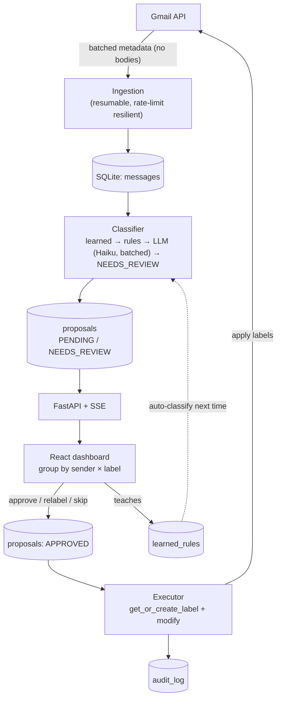
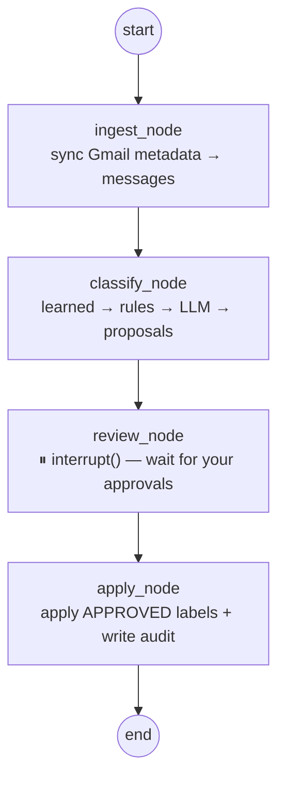

<div align="center">
  
  <h1>Inbox Pilot</h1>
  <p><strong>A human-in-the-loop Gmail organizer.</strong> It ingests mailbox <em>metadata</em>,
  proposes category labels with a rules + LLM classifier, and applies <em>only</em> what you approve —
  reviewing by <code>sender × label</code> so thousands of emails are sorted in a few clicks.</p>
  <p>
    
    
    
    
    
  </p>
  <p><a href="https://chamanthmvs.github.io/Inbox-pilot/"><strong>🌐 Project site</strong></a></p>
</div>

---

## The problem

A large Gmail account is mostly low-value mail — job alerts, promotions, bank
notifications — mixed with the few things that matter. Cleaning it up by hand
across tens of thousands of messages is impractical, and a fully-automatic bot
that silently relabels or deletes your mail is not trustworthy.

**Inbox Pilot** splits the difference: the machine does the reading, sorting and
proposing; **you approve the changes**. The review unit is a *sender + label*
group, so one decision covers hundreds or thousands of emails, and the system
turns each approval into a rule so it needs you less over time. v1 is strictly
**label-only — it never deletes**.

## Architecture



**Key idea:** ingest once into a local store, then classify / review / apply off
that copy — Gmail is touched only to fetch metadata and to apply approved labels.

## Repository layout

| Path | What's there |
| --- | --- |
| [`backend/app/gmail/`](backend/app/gmail/) | `GmailClient` (OAuth, list, batched metadata fetch, labels, history) + MIME parser |
| [`backend/app/store/`](backend/app/store/) | SQLite store: `messages`, `proposals`, `learned_rules`, `audit_log`, `sync_state` |
| [`backend/app/ingestion/`](backend/app/ingestion/) | Incremental sync + the resilient full-inbox crawl |
| [`backend/app/classifier/`](backend/app/classifier/) | Taxonomy loader, rules, batched LLM, 3-state orchestrator, runner |
| [`backend/app/graph/`](backend/app/graph/) | LangGraph workflow, approval service, label executor |
| [`backend/app/api/`](backend/app/api/) | FastAPI app + `RunManager` (background runs, SSE, apply) |
| [`backend/config/taxonomy.yaml`](backend/config/taxonomy.yaml) | The label taxonomy — **data, not code** |
| [`backend/docs/`](backend/docs/) | Plain-language **and** technical write-up per module |
| [`frontend/`](frontend/) | React + Vite dashboard |
| [`docs/`](docs/) | The GitHub Pages site |

## Classification (3-state, "never guess")

1. **Learned rules** — a sender you've approved before is labelled instantly, free. Multi-purpose domains are *not* blanket-labelled.
2. **Rules** — whole-word sender/subject matches from `taxonomy.yaml`, ranked by `(specificity, sender-domain > sender-text > subject-word)`.
3. **LLM** — whatever's left is sent to Claude **in batches of ~20** (cheap Haiku by default) to pick a label from the fixed menu, or abstain.
4. Anything still unsure → **`NEEDS_REVIEW`** for a human. Nothing is force-fit.

Labels are hierarchical (`Finance/Statements`) and the taxonomy is editable YAML.

## The LangGraph workflow (step by step)

Each "Organize" pass is a small **LangGraph state graph**. The key move is the
**pause**: the `review` node calls `interrupt()`, the graph checkpoints its
state, and control returns to the API until *you* decide — then it resumes
exactly where it left off.



| # | Node | Reads | What happens | Writes to state |
| --- | --- | --- | --- | --- |
| 1 | `ingest` | `max_messages` | Full or incremental metadata sync into SQLite | `state.sync` |
| 2 | `classify` | stored messages | 3-state classify → one proposal per message | `state.classify` |
| 3 | `review` | PENDING + NEEDS_REVIEW | **`interrupt()`** → hands the proposals to the UI and **pauses** | `state.decisions` |
| 4 | `apply` | APPROVED proposals | `get_or_create_label` + `modify` + audit log | `state.apply` |

**How the pause actually executes:**

1. The graph is compiled with a **checkpointer** and run under a `thread_id`:
   `graph.invoke({"max_messages": N}, {"configurable": {"thread_id": id}})`.
2. It runs `ingest` → `classify`, hits `review_node`, which calls
   `interrupt({"pending": ..., "needs_review": ...})`. That call **returns** to
   the caller with the payload under `state["__interrupt__"]`; the graph is now
   parked at a checkpoint.
3. The UI shows the proposals; you approve/reject/relabel.
4. The API resumes the *same thread*:
   `graph.invoke(Command(resume=decisions), {"configurable": {"thread_id": id}})`.
   `review_node` records the decisions and execution flows into `apply`.

> In practice the API also exposes **store-driven** paths — the full-inbox crawl
> and a direct `/api/apply` — so bulk review and applying survive browser
> refreshes and restarts, independent of a live graph. The graph above is the
> canonical bounded-run path and the home of the human-in-the-loop `interrupt`.
> Code: [`backend/app/graph/workflow.py`](backend/app/graph/workflow.py).

## API (selected)

| Method | Endpoint | Purpose |
| --- | --- | --- |
| `POST` | `/api/connect` | OAuth connect (no run) |
| `POST` | `/api/runs` · `/api/runs/full` | Bounded run (graph) · full background crawl |
| `GET` | `/api/runs/{id}/stream` | SSE live progress |
| `GET` | `/api/groups` | Proposals grouped by `sender × label` |
| `POST` | `/api/groups/decide` | Bulk approve/reject/relabel a group |
| `POST` | `/api/apply` | Apply all APPROVED labels (direct, store-driven) |
| `POST` | `/api/settings/dry_run` | Toggle LIVE ⇄ DRY-RUN |
| `GET` | `/api/audit` | Audit log |

## Run it

**Prerequisites:** Python 3.13, Node 18+, and a Google OAuth `credentials.json`
in `backend/` (see [`backend/docs/authentication.md`](backend/docs/authentication.md)).

```bash
# install
cd backend && python3 -m venv .venv && source .venv/bin/activate && pip install -r requirements.txt
cd ../frontend && npm install

# enable the cheap LLM classifier (optional but recommended)
cp backend/.env.example backend/.env    # add ANTHROPIC_API_KEY

# run — then open http://localhost:5173
uvicorn app.api.main:app --reload       # from backend/
npm run dev                              # from frontend/
```

> VS Code: Run and Debug → **“▶ Run App (backend + frontend)”** launches both.

Offline tests (no Gmail, no network):

```bash
cd backend && for t in ingestion classifier workflow api; do ./.venv/bin/python tests/test_${t}_offline.py; done
```

## Safety

- **Metadata only** — message bodies are never read or stored.
- **Human approval required** — nothing is applied to Gmail until you approve it.
- **No deletion** — scope is `gmail.modify`; it cannot permanently delete mail.
- **Reversible + audited** — labels are removable; every apply is logged.
- Secrets (`credentials.json`, `token.json`, `.env`) and the local store are git-ignored.

## License

[MIT](LICENSE) © 2026 Chamanth MVS

---

<div align="center">
  <sub>Built by <strong>Chamanth MVS</strong> · with help from Claude Code</sub>
</div>
