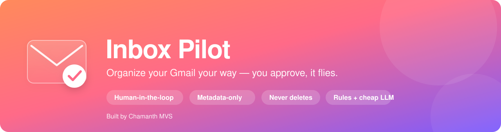
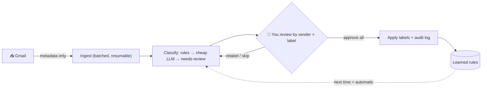

<div align="center">



<br/>

# ✈️ Inbox Pilot

### Organize your Gmail *your way* — the pilot proposes, **you** approve, it flies.

<p>
  
  
  
  
  
</p>

<p>
  
  
  
  
</p>

</div>

---

## 🌱 Why I built this

I had a **huge, overflowing Gmail** — tens of thousands of messages — most of it
job alerts, promotions, bank notifications, and noise I never needed. I wanted to
**organize what matters and clear out what doesn't to reclaim space**, but doing
that by hand across 20,000+ emails is impossible, and I didn't trust a bot to
silently touch my mailbox.

So I built **Inbox Pilot**: it does the heavy lifting — reading, sorting, and
proposing labels — while **I stay in control of every change**. It reviews mail
by *sender + category* so one click handles thousands at once, it learns from my
decisions so it keeps getting faster, and in v1 it is strictly **non-destructive
(labels only, never deletes)** — the "declutter and delete to free space" part is
on the roadmap as a human-approved step, never an automatic one.

> The goal: an inbox you actually control, cleaned in minutes instead of weeks.

---

## ✨ What it does

- 🧲 **Ingests metadata only** — sender, subject, date, snippet. **Never reads or
  stores message bodies.**
- 🏷️ **Proposes category labels** from a fixed, editable taxonomy using a
  3‑stage classifier: **rules → a cheap batched LLM → `NEEDS_REVIEW`** (it refuses
  to guess).
- 🧑‍✈️ **Human-in-the-loop** — nothing touches Gmail until you approve.
- 📦 **Bulk review at scale** — approve a whole **sender × label** group in one
  click; expand to inspect, or relabel before approving.
- 🧠 **Learns as you go** — every approval becomes a rule, so that sender is
  classified for free next time.
- 🛡️ **Safe by design** — label-only, reversible, fully audited, with a one‑click
  **DRY‑RUN** mode.

---

## 🛠️ How it works



**You approve patterns, not emails.** 20,000 messages come from only a few hundred
senders — so you make ~dozens of bulk decisions, not twenty thousand.

---

## 🚀 Quickstart

**Prerequisites:** Python 3.13, Node 18+ *(a local copy is bundled in `.tools/`
for macOS arm64)*, and a Google OAuth `credentials.json` in `backend/`
(see [`backend/docs/authentication.md`](backend/docs/authentication.md)).

```bash
# 1) install (once)
cd backend && python3 -m venv .venv && source .venv/bin/activate && pip install -r requirements.txt
cd ../frontend && npm install

# 2) (recommended) enable the cheap LLM classifier
cp backend/.env.example backend/.env    # then add ANTHROPIC_API_KEY

# 3) run both
#    backend:  uvicorn app.api.main:app --reload      (from backend/)
#    frontend: npm run dev                             (from frontend/)
```

Then open **http://localhost:5173** → **Connect Gmail** → **Organize**.

> **One click in VS Code:** Run and Debug → **“▶ Run App (backend + frontend)”**
> starts both together.

---

## 🧭 The review experience

1. **Connect** your Gmail (OAuth — read + label scope; it *cannot* delete).
2. **Organize** — *Fetch up to N* for a quick pass, or **Everything** for the full
   backlog (a resilient background crawl that survives rate limits and resumes).
3. **Review the dashboard** — stat tiles, a per‑category overview, and
   **grouped cards** by sender × label with **Approve all / Skip / relabel**.
4. **Apply** — approved labels land in Gmail; everything is written to an
   **audit log**. Flip the top‑bar **LIVE ⇄ DRY‑RUN** toggle anytime.

---

## 🔒 Safety & privacy

| Guarantee | How |
| --- | --- |
| No message bodies stored | Ingests Gmail *metadata* only |
| Nothing changes without you | Human approval required before any label is applied |
| No deletion (v1) | Scope is `gmail.modify` — it cannot permanently delete mail |
| Everything reversible | Labels can be removed in one click; every change is audited |
| Secrets stay local | `credentials.json`, `token.json`, the SQLite store, and `.env` are git‑ignored |

---

## 🧱 Tech stack

**Backend** Python · FastAPI · LangGraph (human-in-the-loop `interrupt`) · SQLite ·
Anthropic Claude (batched, cheap).
**Frontend** React + Vite (thin dashboard, SSE live progress).
**Classifier** editable YAML taxonomy · deterministic rules · batched LLM ·
learned sender-rules.

Deep-dive docs live in [`backend/docs/`](backend/docs/) — a plain-language **and**
technical write-up for every module (authentication, ingestion, classification,
workflow, API, frontend).

---

## 🗺️ Roadmap

- [ ] **Declutter & reclaim space** — human-approved *archive / delete* for noise
      buckets (the original motivation), always opt-in, never automatic.
- [ ] **Auto-pilot** — fully auto-label trusted senders after first approval.
- [ ] Per-row relabel inside a group; multi-account support; Postgres for teams.

---

<div align="center">

### Built by **Chamanth MVS**

<sub>with help from Claude Code</sub>

</div>
